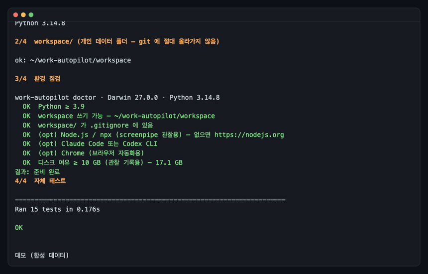
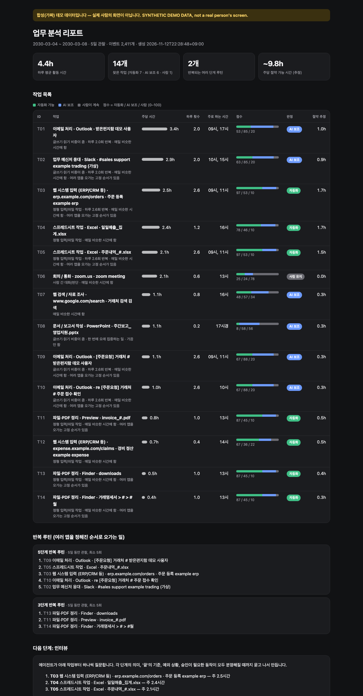
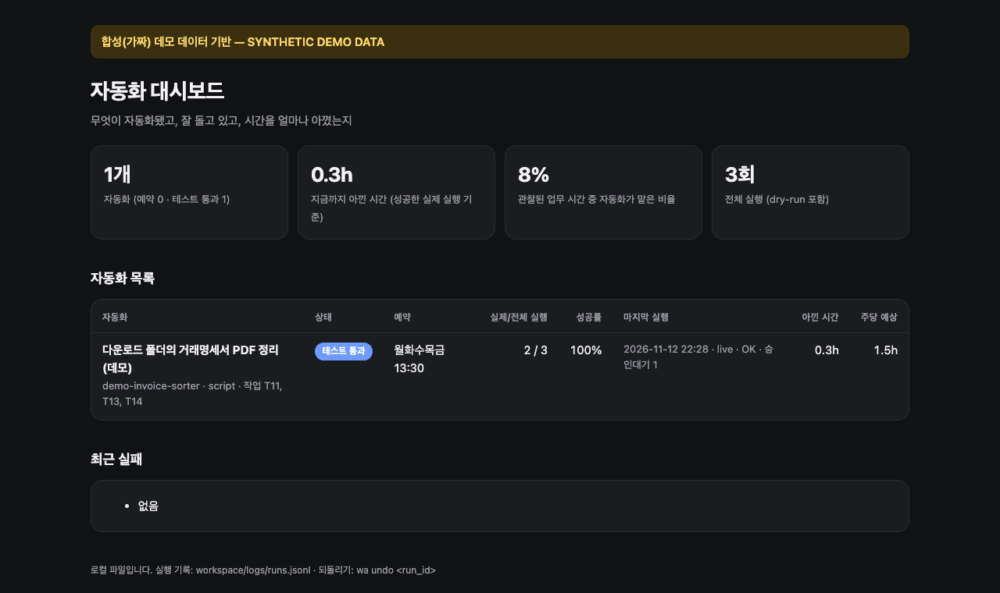

# work-autopilot

**내 업무를 며칠 지켜보고, 자동화할 만한 일을 찾아서, 하나씩 물어본 다음 만들어 주는 도구.**
Claude Code 나 Codex 가 처음부터 끝까지 안내합니다. 설치는 명령어 한 줄.

[English below](#english)



---

## 이런 분께

매일 하는 일 중에 "이거 누가 대신 해줬으면…" 싶은 게 있는데, 뭘 어떻게 자동화해야 할지 모르겠는 분.
엑셀에서 복사해서 사내 시스템에 붙여넣기, 다운로드 폴더 정리, 같은 양식의 메일 답장, 매주 같은 보고서 만들기 같은 일들이요.

work-autopilot 은 이렇게 움직입니다.

| 단계 | 하는 일 | 사용자가 하는 일 |
|---|---|---|
| 1. 관찰 | [screenpipe](https://github.com/screenpipe/screenpipe) 로 3~7일 동안 내 컴퓨터 작업을 **내 컴퓨터 안에서만** 기록 | 기간 정하기, 권한 허용 |
| 2. 찾기 | 어떤 일에 시간을 얼마나, 몇 번 쓰는지 분석해서 작업마다 **자동화 / AI 보조 / 사람이 계속** 점수를 매긴 리포트 | 리포트 보기 |
| 3. 인터뷰 | 에이전트가 애매한 것을 계속 물어봄 — 이 단계는 무슨 뜻인지, 언제 '끝'인지, 예외는 뭔지, 승인이 필요한 건 뭔지 | 대답하기 |
| 4. 만들기 | 일에 맞는 도구로 구현: 스크립트, 앱 API, 브라우저 자동화(CDP/MCP), 꼭 필요한 곳만 AI | — |
| 5. 테스트 | 무조건 dry-run(미리보기) 먼저 → 결과 확인 → 고치고 반복. 실패는 기록 | 결과 확인 |
| 6. 실행 | 예약 실행(Mac launchd / Windows 작업 스케줄러 / Linux cron) + 대시보드에서 아낀 시간 확인 | 승인하기 |

모든 일을 자동화해 준다고 약속하지 않습니다. **자동화할 수 있는 것은 최대한, 사람이 해야 하는 것은 사람에게.**
회의나 판단이 필요한 일은 리포트에서 솔직하게 "사람 유지"라고 나옵니다.

## 분석 리포트 (합성 데이터 예시)



작업별로 주당 시간, 하루 횟수, 주로 하는 시간, 세 가지 점수(자동화 / AI 보조 / 사람), 절약 추정치를 보여 주고,
"메일 확인 → 엑셀 → ERP 입력 → 회신"처럼 **매일 같은 순서로 여러 앱을 오가는 루틴**도 찾아냅니다.

## 설치 (명령어 한 줄)

필요한 것: Python 3.9 이상. 관찰 단계에는 Node.js 가 추가로 필요합니다. Claude Code 또는 Codex 를 권장합니다.

**Mac / Linux**
```bash
git clone https://github.com/codingintheusa0402/work-autopilot.git && cd work-autopilot && ./setup.sh --demo
```

**Windows (PowerShell)**
```powershell
git clone https://github.com/codingintheusa0402/work-autopilot.git; cd work-autopilot; powershell -ExecutionPolicy Bypass -File setup.ps1 -Demo
```

`setup` 은 시스템에 아무것도 설치하지 않습니다. 개인 폴더 `workspace/` 를 만들고, 환경을 점검하고, 자체 테스트를 돌린 뒤
`--demo` 면 **가짜 데이터로 전체 흐름**을 보여 줍니다. 화면은 기록하지 않습니다.

## 시작하기

```bash
cd work-autopilot
claude        # 또는 codex
> 시작하자
```

에이전트가 `CLAUDE.md` / `AGENTS.md` 에 적힌 순서대로 안내합니다. 직접 하고 싶다면 `./wa help` (Windows: `wa.cmd help`).

```text
./wa observe start --days 5     # 1 관찰 시작 (3~7일)
./wa observe stop               #   기록 종료 (메타데이터만 남기고 멈춤)
./wa analyze                    # 2 리포트 → workspace/reports/report.html (원본 기록은 자동 삭제)
./wa interview order-entry T03 T05   # 3 질문지 → 에이전트가 하나씩 물어봄
./wa new order-entry --tool browser-cdp   # 4 템플릿으로 만들기
./wa test order-entry           # 5 lint + dry-run
./wa run order-entry --live     #   실제 실행 (테스트 통과한 코드만)
./wa undo <run_id>              #   되돌리기
./wa schedule order-entry --live --apply  # 6 예약
./wa dashboard                  #   대시보드
```

## 안전장치 (코드로 강제됩니다)

- **비밀번호·카드번호·주민번호는 저장도 입력도 하지 않습니다.** 로그인은 사용자가 직접. 자동화 코드에 그런 값이 보이면 `wa test` 가 실패합니다.
- **결제·구매·메시지 발송·삭제·외부 제출·업로드**는 자동화마다 사용자가 터미널에서 직접 `wa approve` 해야만 실행됩니다.
  에이전트나 스크립트는 승인할 수 없게 막혀 있고, 코드가 바뀌면 승인은 자동으로 무효가 됩니다.
- **dry-run 이 기본**입니다. 실제 실행(`--live`)은 dry-run 을 통과한 바로 그 코드만 가능합니다.
- **모든 실행은 기록되고 되돌릴 수 있습니다.** 파일 변경은 백업 후 진행되고 `wa undo` 로 원상복구. 보내기처럼 되돌릴 수 없는 동작은 그렇다고 표시됩니다.
- **데이터는 내 컴퓨터에만.** 기록·리포트·로그·내 자동화는 전부 `workspace/` 에 있고 `.gitignore` 로 막혀 있습니다.



## 개인정보 기본값 (모두 ON)

- 로컬 전용. 원본 화면이나 음성을 어떤 클라우드에도 보내지 않습니다. screenpipe 텔레메트리도 끕니다.
- 비밀번호 관리자(1Password, Bitwarden …), 은행·결제(토스, 카카오뱅크, PayPal …), 개인 메신저(카카오톡, WhatsApp, Telegram …),
  시크릿 창은 **기록에서 제외**됩니다. 목록: [`config/privacy.default.json`](config/privacy.default.json)
- 음성, 키보드 입력, 클립보드는 기록하지 않습니다 (음성은 원하면 켤 수 있고, 켜도 로컬 Whisper 만 사용).
- 분석에는 **시간, 앱 이름, 가린 창 제목, 사이트 도메인**만 씁니다. 이메일·전화번호·긴 숫자는 제목에서 가립니다.
- **분석이 끝나면 원본 기록은 자동 삭제**됩니다.

## screenpipe 에 대해 꼭 알아 두세요

screenpipe 는 다른 회사의 소프트웨어이고, 이 저장소에 포함돼 있지 않습니다. 관찰을 시작하면 screenpipe 의 공식 npm 패키지
(`npx screenpipe record`)가 받아집니다. 데스크톱 앱은 [screenpipe.com/how-to-install](https://screenpipe.com/how-to-install) 에서.

**오픈소스가 아닙니다.** "Screenpipe Commercial License" 라는 소스 공개(source-available) 라이선스이고,
개인적·비상업적 사용, 비영리·교육·연구, 그리고 **조직 규모와 상관없이 최대 7일 평가**가 무료로 허용됩니다.
상업적 사용은 별도 라이선스가 필요하고, 공식 빌드는 screenpipe 약관과 요금제를 따릅니다.
회사에서 쓰기 전에 [LICENSE.md](https://github.com/screenpipe/screenpipe/blob/main/LICENSE.md), [요금제](https://screenpipe.com/pricing),
그리고 **회사의 승인**을 꼭 확인하세요. 자세히: [`docs/screenpipe.md`](docs/screenpipe.md)

## 폴더 구조

```text
work-autopilot/
├── setup.sh / setup.ps1        한 줄 설치 (Mac·Linux / Windows)
├── wa · wa.cmd · wa.py         CLI
├── CLAUDE.md · AGENTS.md       에이전트가 따르는 진행 순서와 안전 규칙
├── autopilot/                  관찰·분석·리포트·인터뷰·실행·예약·대시보드 (Python 표준 라이브러리만 사용)
├── config/                     개인정보 기본값, 작업 분류 규칙
├── templates/automations/      script · browser-cdp · app-api · ai-step 템플릿
├── examples/                   데모 자동화 + 미리 답한 질문지
├── samples/synthetic_week/     합성(가짜) 1주일 데이터
├── tests/                      자체 테스트
└── workspace/                  ← 내 데이터 (git 제외)
```

## 지원 환경

- macOS: 전체 흐름 테스트 완료.
- Windows 10/11: 설치 스크립트·CLI·작업 스케줄러 코드 포함. 아직 실제 Windows PC 에서 끝까지 검증하지 않았습니다 — 문제가 있으면 이슈로 알려 주세요.
- Linux: cron 예약 지원. screenpipe 는 Linux 데스크톱 앱/AppImage 를 제공합니다.

[면책 조항](DISCLAIMER.md) · [MIT License](LICENSE)

---

## English

**work-autopilot watches how you work for a few days, finds what is worth automating, asks you until every step is clear,
then builds the automations — led by Claude Code or Codex.** One-command setup.

1. **Observe** — record 3–7 days with [screenpipe](https://github.com/screenpipe/screenpipe), locally only. Password managers,
   banking and private messaging apps are excluded by default; no audio, keystrokes or clipboard; no telemetry; raw
   recordings are deleted after analysis.
2. **Find** — a report of your tasks with time spent, frequency, and an *automatable / AI-assistable / keep human* score,
   plus the multi-app routines you repeat every day.
3. **Interview** — the agent keeps asking (what a step means, what "done" looks like, edge cases, approvals) until
   each automation is unambiguous.
4. **Build** — the right tool per task: scripts, app APIs, browser automation over the Chrome DevTools port or MCP,
   AI only where judgment is needed.
5. **Test** — dry-run first, always. Fix and repeat. Failures are logged; live runs can be undone.
6. **Run** — scheduled with launchd (macOS), Task Scheduler (Windows) or cron (Linux). A dashboard shows what is
   automated and the time saved (estimates, never "100%").

```bash
git clone https://github.com/codingintheusa0402/work-autopilot.git && cd work-autopilot && ./setup.sh --demo   # macOS/Linux
```
```powershell
git clone https://github.com/codingintheusa0402/work-autopilot.git; cd work-autopilot; powershell -ExecutionPolicy Bypass -File setup.ps1 -Demo
```

**Safety, enforced in code:** no passwords, card or ID numbers are stored or typed; sending, paying, buying, deleting,
submitting and uploading need your explicit per-automation approval at a real terminal (agents can't approve, and
changing the code voids the approval); dry-run by default; every run is logged and file changes are reversible;
all your data stays in the gitignored `workspace/` folder.

**screenpipe is not open source.** It uses the source-available "Screenpipe Commercial License": free for personal
non-commercial, non-profit/educational/research use and for up to 7 days of evaluation at any organization size;
commercial use needs a license; official builds follow screenpipe's terms and plans. It is not bundled here.
Check its terms and your employer's policy before recording a work computer. See [`docs/screenpipe.md`](docs/screenpipe.md).

The demo runs on a clearly **synthetic** sample week (`samples/synthetic_week/`) — no real person's screen.
Windows support is included but not yet verified end to end on a real Windows PC.

[Disclaimer](DISCLAIMER.md) · [MIT License](LICENSE)
